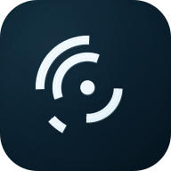
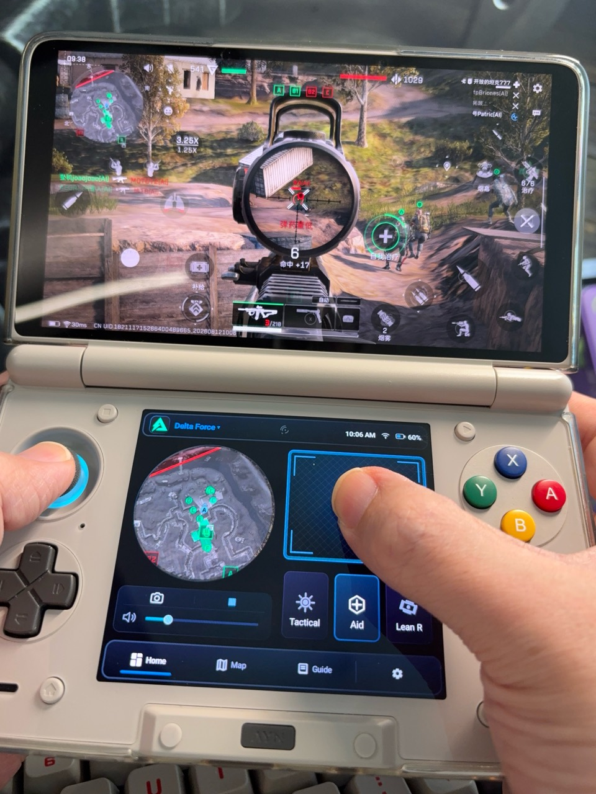
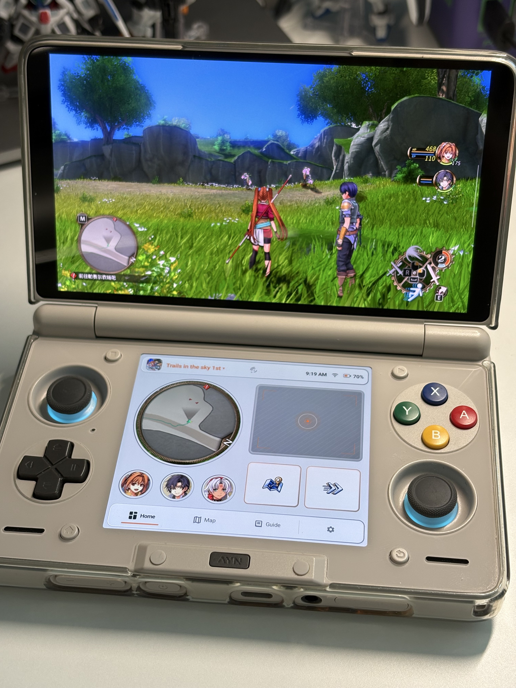
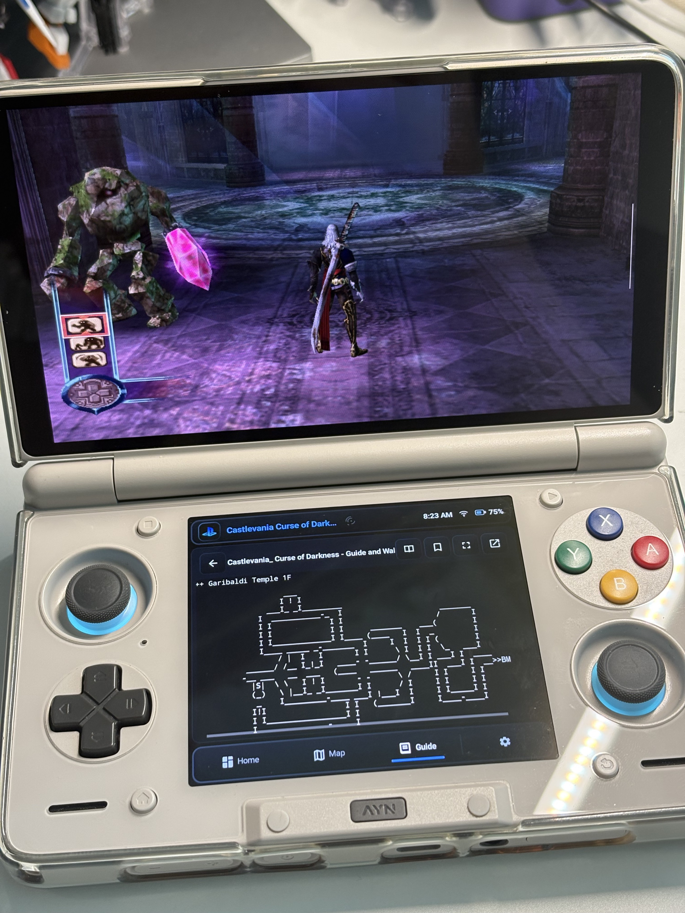
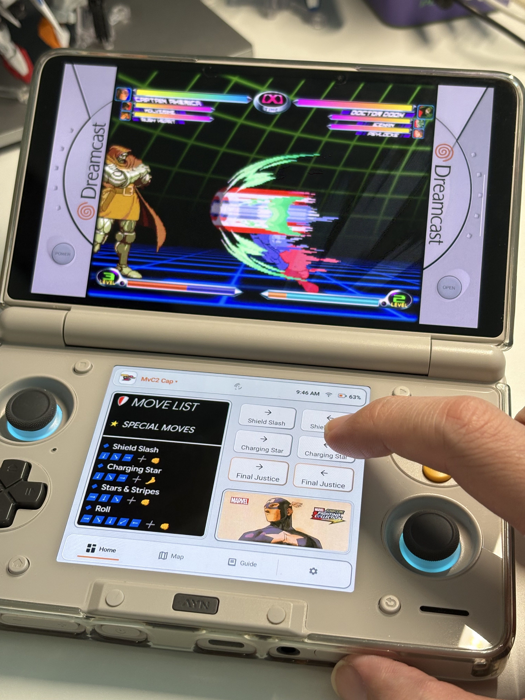
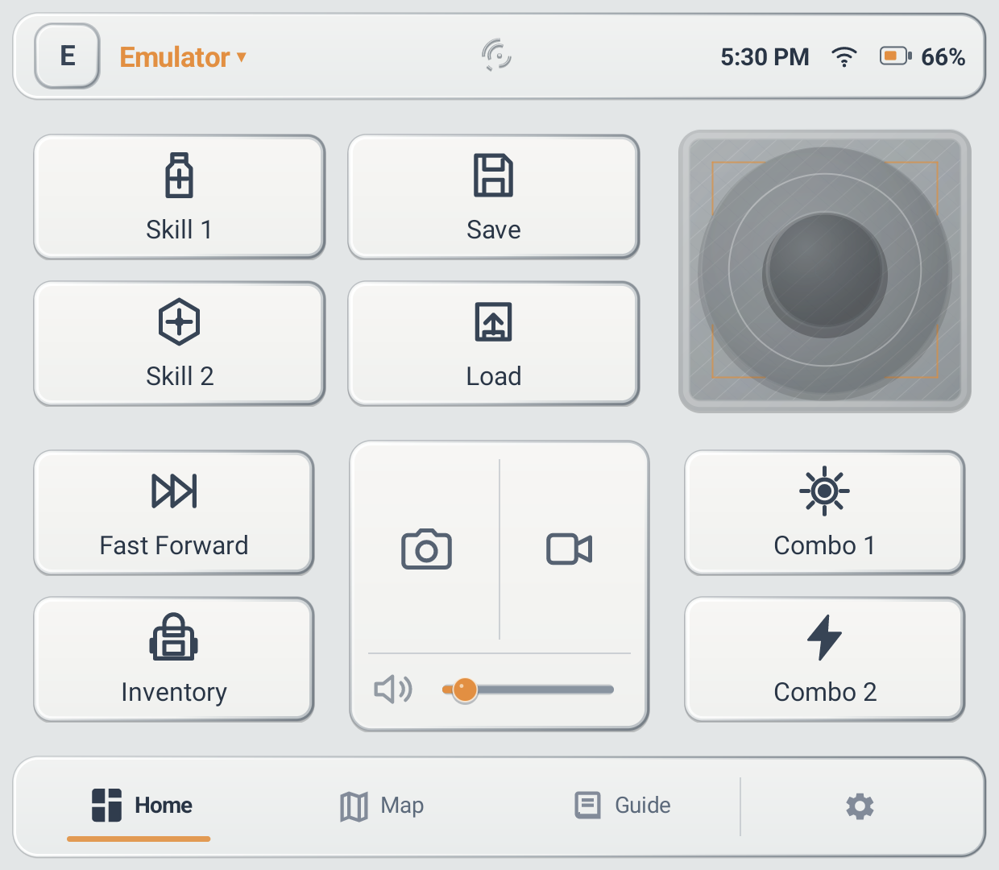
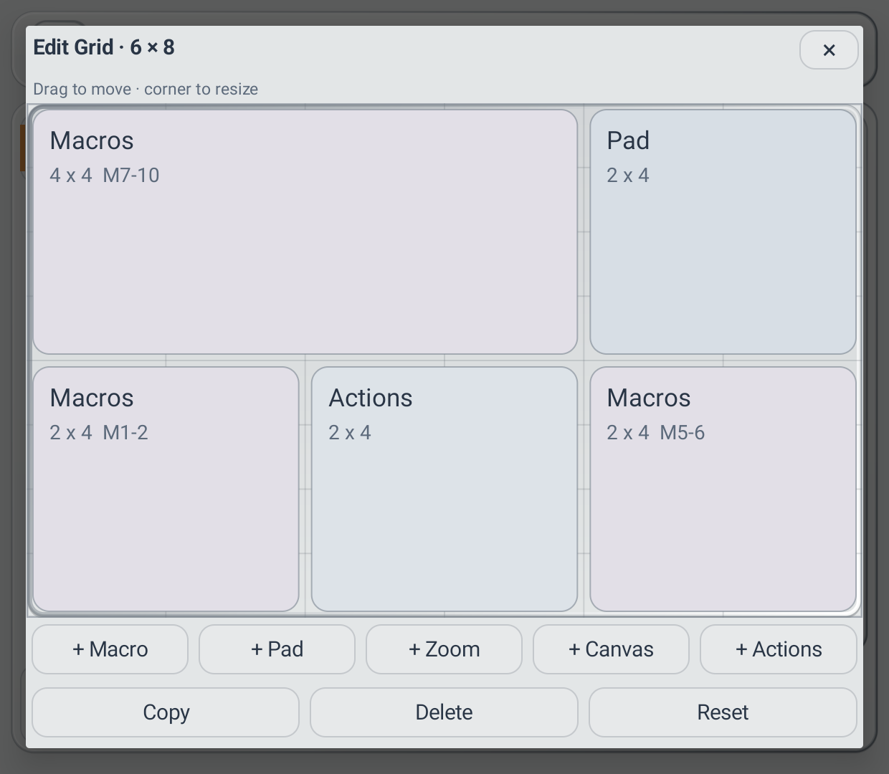

<p align="center">
  
</p>

<h1 align="center">Heimdall</h1>

<p align="center">
  專為 AYN Thor 打造的開源下螢幕遊戲輔助工具
</p>

<p align="center">
  <a href="https://github.com/mastercook777/Heimdall-AYN-Thor-Assistant/releases"><strong>下載 Alpha</strong></a>
  · <a href="#先看結論安裝-heimdall-不需要開發者模式"><strong>設定指南</strong></a>
  · <a href="README.md#start-here-choose-only-what-you-need"><strong>English Setup Guide</strong></a>
  · <a href="https://github.com/mastercook777/Heimdall-AYN-Thor-Assistant/issues">意見反應</a>
</p>

[English](README.md) | [簡體中文](README.zh-CN.md) | **台灣繁體中文**

Heimdall 讓遊戲繼續顯示在 Thor 上螢幕，同時把下螢幕變成常駐控制與資料中心：Profile、巨集、觸控控制、即時翻譯、硬體狀態、地圖、攻略、本地媒體 Canvas、鏡像視窗、螢幕錄影和快捷操作都在拇指可及的位置。

> **Alpha 軟體：** Heimdall 以 AYN Thor 為目標裝置，不承諾相容所有 Thor 韌體、手把模式、遊戲、模擬器或其他雙螢幕裝置。

## Heimdall 在 AYN Thor 實機上的效果

<table>
  <tr>
    <td width="50%"></td>
    <td width="50%"></td>
  </tr>
  <tr>
    <td align="center"><strong>主動操作：</strong>精準瞄準與圓形放大</td>
    <td align="center"><strong>Profile 控制：</strong>鏡像視窗、觸控板與巨集</td>
  </tr>
  <tr>
    <td width="50%"></td>
    <td width="50%"></td>
  </tr>
  <tr>
    <td align="center"><strong>資料查閱：</strong>不遮擋遊戲的本地 Guide</td>
    <td align="center"><strong>快速執行：</strong>Canvas 招式表與結構化巨集</td>
  </tr>
</table>

## Heimdall 能做什麼

| 功能 | 用途 |
| --- | --- |
| Profile 與 Grid | 為不同遊戲分別儲存版面配置、App 綁定、主題、觸控設定、地圖、攻略和 Canvas。直接在 12 × 8 Grid 上拖曳、縮放模組，再明確儲存；還可以瀏覽精選社群 Profile，逐個作為新 Profile 匯入。 |
| 巨集 | 透過結構化編輯器新增點選、長按、滑動、等待和實體手把步驟；手把編輯器支援組合鍵、蓄力、無損重新編輯、鏡像、複製和有邊界取消，不需要手寫指令。 |
| 觸控與瞄準 | 基礎觸控、觸控板拖曳、虛擬右搖桿、精準瞄準、真實相對虛擬滑鼠，以及條件滿足時可與 Thor 內建映射共存的 Shizuku 觸控。 |
| PC 鍵盤 | 經 Shizuku/uinput 提供臨時完整 US ANSI 鍵盤和 Profile 級可設定小鍵盤；這是遊戲中的 PC 輸入，不是 Android IME 文字輸入。 |
| 遊戲資料 | 本地地圖、PDF、攻略、Interactive Map 連結，以及 Profile 級圖片或靜音循環影片 Canvas。 |
| 上螢幕工具 | 上螢幕截圖、螢幕錄影，以及每個 Profile 最多兩個即時鏡像視窗；鏡像視窗可顯示上螢幕選區，也可向該區域傳送單指觸控。 |
| 翻譯與狀態 | 用本地 OCR 辨識上螢幕選區並按 Profile 即時翻譯；在 Thor 向普通 App 暴露所需感測器時，被動顯示 CPU 溫度和記憶體佔用。 |
| 外觀 | 六個已註冊的 Heimdall/Freya 配色、可選的 Profile 主題綁定，以及讓受支援 Thor 搖桿燈跟隨目前主題的全域開關。 |

<table>
  <tr>
    <td width="50%"></td>
    <td width="50%"></td>
  </tr>
  <tr>
    <td align="center"><strong>遊玩介面：</strong>下螢幕控制清晰、易掃視</td>
    <td align="center"><strong>編輯介面：</strong>直接拖曳模組，從可見邊角調整大小</td>
  </tr>
</table>

## 先看結論：安裝 Heimdall 不需要開發者模式

**安裝 Heimdall 不需要 Root，也不需要先進入開發者模式。** 只有玩家要使用 Shizuku 的高階控制功能時，才需要為無線偵錯開啟開發者選項。

| 你想使用的功能 | 需要做什麼 |
| --- | --- |
| Profile、Grid、地圖、攻略、Canvas、瀏覽社群 Profile 和普通介面 | 只安裝 Heimdall；瀏覽目錄和下載社群 Profile 需要網路連線。 |
| 向上螢幕傳送點選、長按、滑動或相容觸控板拖曳 | 為「基礎觸控」啟用 Heimdall 無障礙服務。 |
| 即時翻譯 | 為上螢幕截圖啟用 Heimdall 無障礙服務，再設定受支援的 HTTPS 翻譯服務和 API Key。本地完成 OCR，辨識出的文字會傳送給所選服務。 |
| 實體手把錄製/重播、虛擬右搖桿、精準瞄準、虛擬滑鼠、PC 鍵盤或映射相容的增強觸控 | 安裝、啟動並授權 Shizuku；透過無線偵錯啟動時才需要開發者模式。 |
| 僅觀看或可互動式鏡像視窗、螢幕錄影 | 功能首次啟動時，按 Android 系統提示允許螢幕擷取；可互動式鏡像視窗還需要 Shizuku 和可用的增強觸控路線。 |

第一次開啟 Heimdall 時不需要把所有權限一次開完。先建立一個 Profile，只設定馬上要用的一條路線，測試成功後再增加功能。

## 1. 下載與安裝

1. 開啟 [Heimdall Releases 頁面](https://github.com/mastercook777/Heimdall-AYN-Thor-Assistant/releases)。
2. 開啟最新的、帶固定版本號的 Alpha。
3. 下載名稱類似 `heimdall-vX.Y.Z-alpha.N.apk` 的檔案。同一版本還會提供 `SHA256SUMS.txt`，可用於核對檔案完整性。
4. 在 Thor 的檔案管理員中開啟 APK。
5. 如果 Android 提示「允許此來源安裝應用程式」，只為目前檔案管理員開啟安裝權限，然後返回安裝頁面。
6. 完成安裝並開啟 Heimdall。

請只安裝本儲存庫不可覆蓋、帶版本號的正式 Release。可變的私有開發 `debug-latest` 不是公開發行版；不要安裝來源不明或被重新簽名的 APK。

### 更新或從舊測試版遷移

使用同一公開簽名的後續 Alpha 通常可以覆蓋安裝。除非發行說明明確要求，否則不要先解除安裝：解除安裝會刪除本地 Profile 資料和已匯入資源。

早期測試包和新的 Debug 包可能是獨立 App，與公開包 `com.mastercook777.heimdall` 不共享資料。

從舊測試版遷移前：

1. 在舊版 Profile 管理中選擇「匯出全部 Profile」。
2. 把匯出檔案儲存在容易找到的位置。
3. 安裝並開啟公開 Alpha。
4. 重新授權實際使用的服務。
5. 匯入該檔案；確認關鍵 Profile 正常後，再刪除舊版或舊備份。

舊版匯出的是僅含設定的 JSON；新版仍可匯入，但源資源丟失時無法恢復。目前版本匯出自包含 `.heimdall-profile` 遷移包，包含 Profile 資料以及受支援的 Profile 圖示、地圖、檔案 Guide、使用者巨集圖示和 Canvas 媒體。

## 2. 建立第一個 Profile

1. 開啟 **設定 > Profile 管理**。
2. 為一個常玩的遊戲或模擬器建立 Profile。
3. 先在上螢幕啟動目標 App，再從 Heimdall 的最近執行 App 中完成綁定。
4. 選擇 Grid 預設。新手建議從 **Balanced（平衡）** 開始；**Controls（操控）** 為觸控控制留出更多空間，**Macros（巨集）** 顯示更多操作。
5. 先只新增馬上要用的模組。
6. 點選設定頁底部的 **儲存**。
7. 回到遊戲，確認 Heimdall 能選中正確的 Profile。

> **儲存邊界：** Grid 和部分 Profile 設定採用預覽/草稿狀態。看到預覽不代表已經寫入；離開編輯器或設定前要明確儲存。

## 3. 啟用基礎觸控（可選）

基礎觸控透過 Android 無障礙服務，把相容的點選、長按、滑動和觸控板拖曳傳送到上螢幕。它不需要 Shizuku，也不需要開發者模式。

1. 在 Heimdall 中開啟 **設定 > 連線與權限**。
2. 找到 **基礎觸控**，點選啟用操作。
3. 在 Android 無障礙設定中找到 Heimdall，閱讀系統提示後開啟服務。
4. 返回 Heimdall，確認基礎觸控顯示可用。
5. 先測試一個簡單點選巨集或觸控板動作，再建立較長的巨集。

> 基礎無障礙觸控和 Thor 內建按鍵映射使用不同的觸控流，同時操作時可能互相取消。需要共存時，只在 Heimdall 明確顯示可用的情況下使用映射相容的增強觸控路線。

## 4. 為高階控制設定 Shizuku（可選）

實體手把錄製/重播、虛擬右搖桿、精準瞄準和映射相容的增強觸控需要 Shizuku。Heimdall 本身不需要 Root。

- [Shizuku 官方 Releases](https://github.com/RikkaApps/Shizuku/releases)
- [Shizuku 官方中文設定指南](https://shizuku.rikka.app/zh-hans/guide/setup/)

### 從來沒有開過開發者模式？按下面做

不同 Thor 韌體的 Android 選單名稱可能略有區別。如果找不到某一項，可以直接使用系統設定頂部的搜尋框，搜尋「版本號」「開發者選項」或「無線偵錯」。

1. 開啟 Thor 的 **Android 系統設定**。
2. 進入 **關於裝置**、**關於掌機**，或名稱相近的頁面。
3. 找到 **版本號 / Build number**。部分韌體會把它放在「軟體資訊」或「版本資訊」裡面。
4. **連續點選版本號 7 次。**
5. 如果系統要求，輸入鎖屏密碼。隨後應出現「您已處於開發者模式」之類的提示。
6. 返回 **系統 > 開發者選項**；如果仍找不到，就在系統設定中搜索「開發者選項」。
7. 開啟 **USB 偵錯**。
8. 進入 **無線偵錯**，開啟無線偵錯開關。

至此開發者選項已經開啟。這八步通常只需要做一次。

### 配對並啟動 Shizuku

1. 安裝並開啟 Shizuku。
2. 選擇 **透過無線偵錯啟動**，然後開始配對。
3. 返回 Android 的 **無線偵錯** 頁面。
4. 選擇 **使用配對碼配對裝置**。
5. 把系統顯示的配對碼輸入 Shizuku 通知或配對頁面。
6. 返回 Shizuku，點選 **啟動**，等待狀態顯示 Shizuku 正在執行。
7. 開啟 **Heimdall > 設定 > 連線與權限 > 高階控制**。
8. 點選授權/連線，在 Shizuku 授權視窗中允許 Heimdall。
9. 返回 Heimdall，確認高階控制顯示可用。

Thor 重新啟動後，在使用控制器功能前先檢查 Shizuku 狀態。如果服務已經停止，需要重新點選啟動；通常不需要再次配對。

如果 Shizuku 一直顯示「正在搜尋配對服務」，請允許它在後臺執行並開啟通知，保持本地網路和無線偵錯可用，然後嘗試關閉再重新開啟一次無線偵錯。不同系統的最新處理方式請參考 [Shizuku 官方中文手冊](https://shizuku.rikka.app/zh-hans/guide/setup/)。

## 5. 開始使用 Heimdall

### Grid 與模組

在視覺化 Grid 編輯器中新增、拖曳、縮放或刪除模組；模組會吸附到 12 × 8 Grid。舊 Alpha 的版面配置會向前遷移；繼續編輯和儲存前請先檢查結果。先預覽，再明確儲存 Grid 和目前 Profile。

### 觸控巨集

1. 在 Grid 中新增巨集模組。
2. 長按巨集按鈕約 1.8 秒，開啟結構化編輯器。
3. 新增點選、長按、滑動或等待步驟。
4. 擷取座標時，直接在上螢幕目標位置操作。
5. 儲存巨集，返回主介面，按一下按鈕執行。

### 實體手把巨集

控制器錄製和重播需要 Shizuku 與可用的高階控制路線。Thor 內建映射可能使已經映射的實體按鍵無法進入 Heimdall 錄製流。遇到這種情況時，可以開始錄製後暫時回到 Android 桌面按下目標按鍵，再返回 Heimdall 檢查並儲存序列。

增強觸控預設保護 Thor 內建映射，並會在重播前拒絕包含實體手把步驟的巨集。如果目前遊戲沒有啟用內建映射，可以為目前 Profile 主動關閉該保護；螢幕步驟仍嚴格使用映射相容觸控路線，不會回退到無障礙。

### 觸控板、虛擬右搖桿與精準瞄準

- **觸控拖曳：** 把下螢幕手指移動轉換為上螢幕拖曳。
- **虛擬右搖桿：** 透過高階控制傳送 Thor 右搖桿輸入；鬆手後應立即回中。
- **精準瞄準：** 用於小幅視角修正。建議從低靈敏度開始，大幅轉向繼續使用實體搖桿。

### 鏡像視窗、社群 Profile、地圖、攻略與 Canvas

- 一個 Profile 的 Grid 最多可放兩個鏡像視窗。每個鏡像視窗分別儲存上螢幕區域、縮放、形狀、影格率及「僅觀看」或「可互動」模式，共用一次螢幕擷取。可互動模式經可用的 Shizuku 增強觸控路線傳送單指輸入，同時只能有一個鏡像視窗手勢。鏡像視窗與螢幕錄影不能同時執行。在鏡像設定中選區後按「儲存」；Grid 位置另行儲存。
- 在 Profile 管理中開啟**社群 Profile**，瀏覽精選目錄。下載內容會按目錄記錄的大小和 SHA-256 校驗，再作為 `.heimdall-profile` 遷移包驗證並追加為新 Profile，不會替換已有 Profile。目錄和遷移包來自[社群儲存庫](https://github.com/mastercook777/heimdall-community-profiles)。
- 地圖與攻略屬於目前 Profile，可以儲存本地圖片、PDF、文本或 Interactive Map 地址。
- Canvas 支援本地 JPG、PNG、GIF、WebP 和 MP4。GIF 與動態 WebP 需要 Android 9 或更高版本；MP4 始終靜音並循環播放。一個 Profile 可以新增多個獨立靜態 Canvas，但 GIF、動態 WebP 和 MP4 合計最多一個動態 Canvas。檔案不超過 50 MiB；圖片不超過 4096 × 4096，MP4 最長邊不超過 2048；不支援 APNG。連按兩下進入全螢幕檢視，長按更換媒體或調整構圖。

### 即時翻譯與硬體監控

- 在 Profile 中新增一個翻譯模組，長按選擇上螢幕區域、OCR 文字型別和目標語言，再儲存元件。執行中的快速選區只提交確認過的區域，不會順帶儲存無關的 Grid 位置變化。
- 翻譯使用 Heimdall 無障礙截圖和內建 ML Kit 在本機完成 OCR，不佔用 MediaProjection。只有辨識出的文字會透過 HTTPS 傳送給已設定的 SiliconFlow 或自訂 OpenAI 相容 `/chat/completions` 介面。
- 翻譯服務與 API Key 屬於 App 全域設定。API Key 使用 Android Keystore 加密，不會寫入 Profile JSON 或 `.heimdall-profile` 匯出。
- 「測試連線」只檢查目前設定草稿；測試成功後，仍需點選設定頁底部的「儲存」，該服務設定才會生效。
- 每個 Profile 可以新增一個硬體監控模組，顯示 CPU 溫度和已用/總記憶體。它不需要 Shizuku；當普通 App 無法唯一讀取 Thor 的已驗證 CPU 感測器時會顯示不可用，不會猜測數值。

### 主題與搖桿燈光

在「外觀」中選擇已註冊的 Heimdall 或 Freya 配色。Profile 可以儲存自己的主題，也可以跟隨 App 預設主題。可選的 **匹配搖桿燈光** 是預設關閉的 App 全域開關；在受支援的 Thor 韌體上，它會把目前主題顏色與統一亮度應用到兩個搖桿燈環。該功能不使用 Shizuku、Root、輪詢、動畫或遊戲事件；韌體燈光呼叫不可用時，不影響主題本身。

### 截圖與螢幕錄影

Quick Actions 可以擷取上螢幕。螢幕錄影使用 Android MediaProjection 和 Audio Playback Capture，而不是麥克風輸入；上螢幕應用仍可以禁止自身遊戲聲音被擷取。

## 6. 解除安裝前先備份

完成重要 Grid 或巨集設定後，進入 Profile 管理匯出目前或全部 Profile，並在 Heimdall 之外儲存副本。`.heimdall-profile` 會自包含受支援的 Profile 資源，並在匯入前完成完整校驗。Heimdall 會為部分破壞性 Profile 操作保留有限恢復快照，但自動快照不能代替手動匯出。格式細節見 [Profile 遷移包格式](docs/PROFILE_BUNDLE_FORMAT.zh-CN.md)。

Alpha 預設關閉 Android 平臺備份。解除安裝應用程式會刪除 Heimdall 本地資料。

## Alpha 已知限制

- 映射相容的 Shizuku 觸控只在已測試的 Thor、韌體、遊戲和映射組合上完成驗證；其他韌體可能顯示不可用。
- 基礎無障礙觸控與 Thor 內建按鍵映射同時操作時可能互相取消。
- Thor 映射可能隱藏巨集錄製需要的已映射實體按鍵。
- 每個 Profile 最多支援兩個即時鏡像視窗；可互動輸入僅支援單指，且同一時間只能有一個鏡像視窗手勢。鏡像視窗不能與螢幕錄影共享 MediaProjection。
- 從其他下螢幕 Tab 返回 Main 後，凍結鏡像視窗的 Stop 標記偶爾可能不顯示；停止後也可能保留最後一幀。這是已知顯示狀態問題，不代表畫面仍在即時更新。
- 翻譯質量、延遲和服務可用性取決於 OCR 文字型別、網路、模型與服務商。機主已驗證的是 SiliconFlow 中國區配合 Hunyuan-MT-7B；其他列出的服務或自訂 OpenAI 相容介面屬於協議相容，並非都完成 Thor 實機驗證。
- 硬體監控只有在 Thor 向普通 App 暴露唯一、可讀的 `cpu-0-1` 溫度源時才顯示 CPU 溫度；它不會拿電池溫度代替，也不會估算風扇轉速。
- 主題匹配搖桿燈為可選功能，預設關閉，使用 Thor 原廠燈光協議；如韌體表現不同，請使用 Thor 原廠燈光設定恢復或關閉。

本版內容和已知限制請閱讀 [v0.4.0-alpha.1 發行說明](docs/releases/v0.4.0-alpha.1.md)。經過版式檢查的 0.2.0 [English](docs/guides/Heimdall-0.2.0-alpha.1-User-Guide-en.pdf) 與[簡體中文](docs/guides/Heimdall-0.2.0-alpha.1-User-Guide-zh-CN.pdf) PDF 繼續作為歷史參考保留；目前設定說明以本 README 為準。

## 如何提供有效反饋

請透過 [GitHub Issues](https://github.com/mastercook777/Heimdall-AYN-Thor-Assistant/issues) 反饋，並儘量附上：

- Heimdall 版本與 Thor 韌體版本。
- 手把模式：原生 / Xbox。
- 遊戲或模擬器名稱。
- 使用的路線：基礎觸控 / Shizuku。
- 是否開啟 Thor 內建按鍵映射。
- 完整重現步驟和出現頻率。
- 可以提供時附上截圖或螢幕錄影。
- 重新啟動 Heimdall、重新啟動 Shizuku 或重新授權後結果是否變化。

<details>
<summary><strong>從原始碼構建</strong></summary>

要求：

- JDK 17
- Android SDK 35
- CMake 3.22.1
- Android NDK `30.0.14904198`

構建 Debug APK：

```text
./gradlew :assistant:assembleDebug --no-daemon
```

執行 Alpha 使用的同類靜態檢查：

```text
./gradlew :assistant:lintDebug --no-daemon
```

公開儲存庫不包含簽名金鑰。本地 Debug 使用 Android 開發簽名；公開 Alpha 只由受 Tag 約束的釋出工作流配合外部私有簽名金鑰生成。

</details>

## 資料、隱私與貢獻

除非玩家主動匯入或匯出，Profile 資料只儲存在裝置本地。聯網權限用於玩家自行設定的 Interactive Map 頁面和可選的翻譯請求。翻譯 OCR 在本機完成，但辨識出的文字會傳送給玩家選擇的翻譯服務。詳見 [docs/PRIVACY.zh-CN.md](docs/PRIVACY.zh-CN.md)。

提交更改前請閱讀 [CONTRIBUTING.md](CONTRIBUTING.md)（英語）。原生輸入、跨屏路由、MediaProjection、效能和實體操作體驗都需要範圍明確的 AYN Thor 實機證據。

## 許可證

Heimdall 原始碼採用 Apache License 2.0，詳見 [LICENSE](LICENSE)、[NOTICE](NOTICE) 和 [THIRD_PARTY_NOTICES.md](THIRD_PARTY_NOTICES.md)。

AYN 與 Thor 是其各自權利人的商標。Heimdall 是社群專案，不代表 AYN 官方應用。
